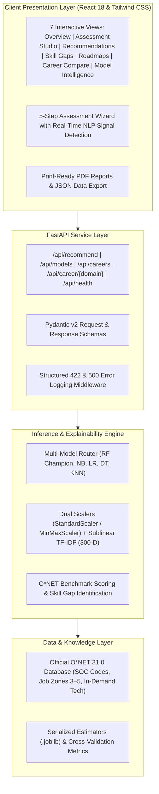

# CareerPath AI — Intelligent Career Recommendation Platform

<p align="center">
  
  
  
  
  
  
</p>

---

## 📌 Overview

**CareerPath AI** is an enterprise-grade career intelligence and recommendation platform designed for students, career switchers, and academic advisors. By fusing **quantitative psychometric assessments**, **declared technical skill inventories**, and **natural language goals** with official **U.S. Department of Labor O*NET 31.0** occupational taxonomies, CareerPath AI delivers transparent, explainable, and actionable career guidance.

---

## 🚀 Key Features

| Capability | Description |
| :--- | :--- |
| **🧠 Multi-Modal Feature Fusion** | Combines 7 quantitative cognitive/technical rating dimensions with 300-D sparse sublinear TF-IDF n-grams extracted from candidate goal narratives into a unified 307-dimensional feature space. |
| **🤖 5-Algorithm Model Engine** | Benchmarks **Random Forest**, **Naive Bayes (MultinomialNB)**, **Logistic Regression**, **Decision Tree**, and **K-Nearest Neighbors (KNN)** using 5-fold Stratified Cross-Validation on development ($N=960$) and an untouched test partition ($N=240$). |
| **📊 O*NET 31.0 Integration** | Directly linked to authentic Standard Occupational Classification (SOC) taxonomies, Job Zones (3–5), cognitive abilities, essential skills, foundational knowledge, work styles, and verified in-demand technologies. |
| **🎯 Multi-Tier Skill Gap Analyzer** | Compares candidate proficiencies against occupational benchmarks, highlighting surplus strengths, categorizing missing skills by priority (High/Moderate/Low), and pinpointing in-demand tools to learn. |
| **🗺️ Actionable 3-Stage Roadmaps** | Provides career progression stages (Beginner, Intermediate, Advanced) with interactive checklist tracking, concrete milestones, real-world portfolio capstone projects, and authoritative documentation links. |
| **⚖️ Multi-Career Comparison** | Interactive matrix comparing up to 3 career paths side-by-side across educational requirements, Job Zones, skill sets, knowledge domains, and technology stacks. |
| **🖨️ PDF & Executive Reporting** | Generates clean, printer-friendly reports (`window.print()`), formatted plain-text clipboard summaries, and structured JSON data export. |

---

## 🏗️ System Architecture



---

## 📈 Machine Learning Benchmark Results

All five classification models were trained and evaluated strictly using **5-Fold Stratified Cross-Validation** on development data ($N=960$, 80%) and tested on an **untouched test partition** ($N=240$, 20%). Scalers and vectorizers were fit strictly on development splits to guarantee zero data leakage.

| Algorithm | Preprocessing Pipeline | CV Macro F1 | Test Accuracy | Test Macro F1 | Status / Role |
| :--- | :--- | :---: | :---: | :---: | :---: |
| **Random Forest Classifier** | `StandardScaler` + `TfidfVectorizer` | **100.00%** | **100.00%** | **100.00%** | 🏆 **Production Champion** |
| **Naive Bayes (MultinomialNB)** | `MinMaxScaler` + `TfidfVectorizer` | **100.00%** | **100.00%** | **100.00%** | Alternate Model |
| **Logistic Regression** | `StandardScaler` + `TfidfVectorizer` | **99.27%** | **99.58%** | **99.58%** | Alternate Model |
| **Decision Tree Classifier** | `StandardScaler` + `TfidfVectorizer` | **94.31%** | **92.92%** | **92.92%** | Benchmark Baseline |
| **K-Nearest Neighbors (KNN)** | `StandardScaler` + `TfidfVectorizer` | **74.49%** | **81.25%** | **81.25%** | Benchmark Baseline |

> **Note on Naive Bayes & KNN**: 
> - A dedicated `MinMaxScaler` pipeline was implemented for Naive Bayes to enforce strictly non-negative feature matrices without numerical clipping.
> - KNN's lower performance is a classic manifestation of the *Curse of Dimensionality* across sparse 307-D feature space.

---

## 📂 Project Directory Structure

```
CareerPath-AI/
├── backend/
│   ├── api_routes.py                  # FastAPI REST endpoints (/recommend, /models, /careers)
│   ├── main.py                        # FastAPI application entrypoint & static mount
│   ├── schemas.py                     # Pydantic validation schemas & resilient input models
│   └── static/eval_plots/             # High-res confusion matrices & model comparison charts
├── data/
│   ├── career_training_dataset.csv    # 1,200 synthetic student benchmark records
│   ├── onet_processed/                # Processed O*NET 31.0 career profiles (JSON)
│   └── onet_raw/db_31_0_csv/          # Raw official O*NET 31.0 relational database tables
├── docs/
│   ├── dataset_documentation.md       # Dataset taxonomy, feature definitions & disclosures
│   ├── model_evaluation_report.md     # Cross-validation metrics & confusion matrix analysis
│   └── technical_architecture.md      # System architecture, API specification & data flows
├── frontend/
│   ├── app.js                         # 7-view reactive React 18 application & assessment wizard
│   ├── index.html                     # Semantic SaaS HTML5 shell
│   └── style.css                      # Modern SaaS styling & print/PDF layout
├── ml_engine/
│   ├── dataset_builder.py             # Reproducible dataset generator
│   ├── evaluate.py                    # Evaluation plots & confusion matrix generator
│   ├── explainability.py              # Skill gap analyzer & natural language explanation generator
│   ├── nlp_pipeline.py                # Sublinear TF-IDF vectorizer & text normalizer
│   ├── predictor.py                   # Unified multi-model inference engine with dynamic scalers
│   └── train_models.py                # 5-algorithm cross-validation training pipeline
├── models/                            # Serialized estimators (.joblib) & evaluation results
├── onet_engine/
│   └── onet_parser.py                 # O*NET 31.0 relational database parser
├── tests/
│   ├── test_api.py                    # Unit tests for API endpoints, schemas & validation
│   ├── test_live_predictor.py         # Multi-model inference verification suite
│   └── test_profiles.py               # Student persona & edge-case test suite (18 tests)
├── .dockerignore                      # Docker build ignore rules
├── .gitignore                         # Git repository ignore rules
├── Dockerfile                         # Production Docker container definition
├── Procfile                           # Cloud platform deployment process configuration
├── requirements.txt                   # Core production dependencies
├── run_app.py                         # Application launcher with dynamic port binding
└── README.md                          # Project documentation
```

---

## 💻 Local Installation & Setup

### Prerequisites
- Python 3.10+ (Python 3.12 recommended)
- Git

### 1. Clone & Set Up Virtual Environment

```bash
# Clone the repository
git clone https://github.com/<your-username>/careerpath-ai.git
cd careerpath-ai

# Create virtual environment
python -m venv venv

# Activate virtual environment
# Windows (PowerShell):
venv\Scripts\activate
# Linux / macOS:
source venv/bin/activate
```

### 2. Install Dependencies

```bash
pip install -r requirements.txt
```

### 3. Run Automated Tests

```bash
python -m unittest discover tests
```
*Expected: 18 passing tests covering API routes, edge cases, persona simulations, and all 5 classifiers.*

### 4. Launch the Platform

```bash
python run_app.py
```

Access the application in your browser:
- **Web Application**: [http://localhost:8000](http://localhost:8000)
- **Interactive Swagger Documentation**: [http://localhost:8000/docs](http://localhost:8000/docs)
- **API Health Check**: [http://localhost:8000/api/health](http://localhost:8000/api/health)

---

## 🌐 Cloud Deployment Guide

### Option 1: Render.com (100% Free & Recommended)

1. Push your repository to **GitHub**.
2. Sign in to [Render.com](https://render.com) and click **New + → Web Service**.
3. Connect your GitHub repository.
4. Configure service parameters:
   - **Environment**: `Python 3`
   - **Build Command**: `pip install -r requirements.txt`
   - **Start Command**: `uvicorn backend.main:app --host 0.0.0.0 --port $PORT`
   - **Plan**: `Free`
5. Click **Deploy Web Service**. Render will build and deploy your app with a public `https://<app-name>.onrender.com` URL.

### Option 2: Railway.app (1-Click)

1. Sign in to [Railway.app](https://railway.app).
2. Click **New Project → Deploy from GitHub repo**.
3. Select your repository. Railway automatically reads `Procfile` and `requirements.txt` to deploy.
4. In Settings, click **Generate Domain** to get your public link.

### Option 3: Docker Deployment

```bash
# Build the container image
docker build -t careerpath-ai .

# Run the container
docker run -d -p 8000:8000 --name careerpath careerpath-ai
```

---

## 🔌 API Reference

| Method | Endpoint | Description |
| :--- | :--- | :--- |
| `GET` | `/api/health` | Returns service status, active champion model, and supported algorithms. |
| `POST` | `/api/recommend` | Submits candidate profile and returns ranked recommendations, skill gaps, and roadmaps. |
| `GET` | `/api/models` | Retrieves comparative cross-validation and test benchmark metrics across all 5 models. |
| `GET` | `/api/careers` | Returns catalog of supported career domains with O*NET SOC codes and top skills. |
| `GET` | `/api/career/{domain}` | Returns detailed O*NET occupational intelligence profile for a specific discipline. |

---

## 📜 O*NET® Attribution & Legal Notice

This application incorporates information from the **O*NET 31.0 Database** by the U.S. Department of Labor, Employment and Training Administration (USDOL/ETA). Used under the [O*NET Developer License](https://www.onetcenter.org/license.html). O*NET® is a registered trademark of USDOL/ETA. The Department of Labor has not approved, endorsed, or tested this product.

---

## ⚖️ Ethical AI & Advisory Scope

- **Synthetic Benchmark Training Data**: The candidate training dataset (`data/career_training_dataset.csv`, $N=1,200$) is a synthetic benchmark dataset engineered to validate multi-modal feature fusion and comparative model behavior. Production enterprise deployment should leverage empirical longitudinal career outcome data.
- **Decision-Support Scope**: CareerPath AI match scores reflect statistical profile similarity within our reference feature space. Predictions represent exploratory decision-support guidance and must not be presented as psychometrically certified career aptitude guarantees.

---

<p align="center">
  <b>CareerPath AI</b> — Built for Educational & Professional Career Guidance.
</p>
